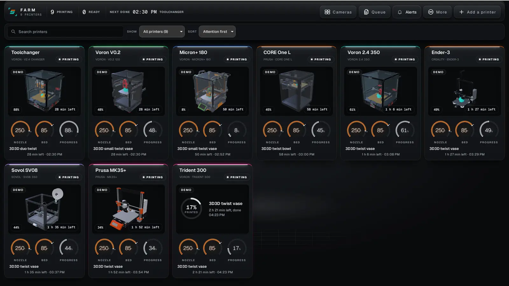
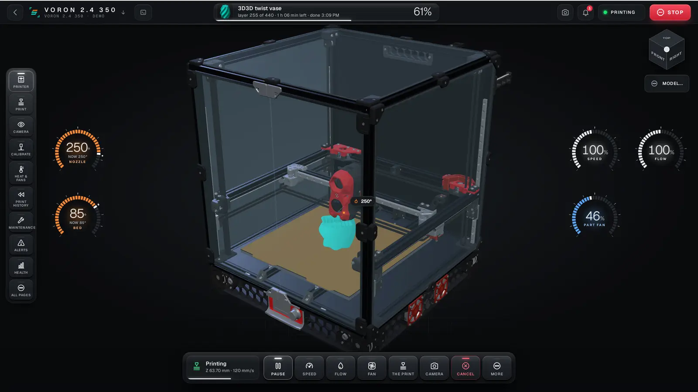
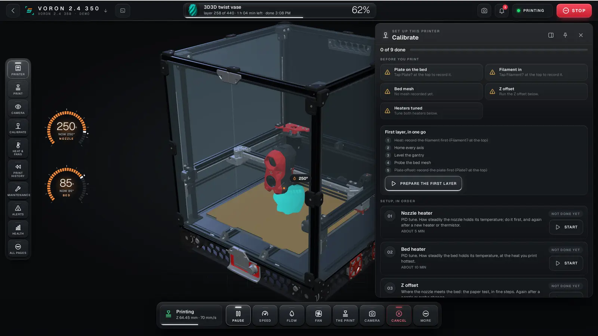
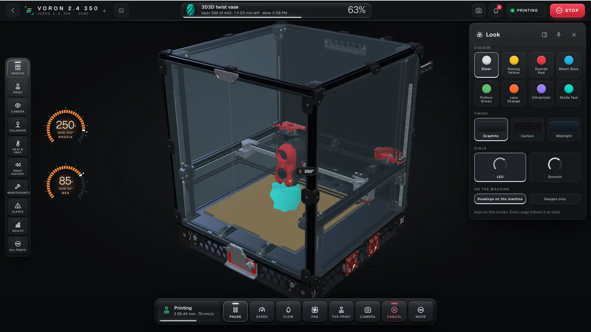

# Stella Scope

**A cockpit and flight recorder for a whole print farm: Klipper, Prusa and FlashForge printers on one wall. It records everything each printer reports, lets you rewind to any moment, calibrates the machine step by step, keeps a timelapse and a report of every print, and shows each printer in 3D, on your computer or your phone.**



Built by [3D3D](https://3d3d.ca) in New Brunswick, Canada, on and for our own farm: a Voron 2.4 R2 350, a Prusa CORE One L, a FlashForge Adventurer 5M and an Anycubic Kobra X. Downloads and a plain-language overview: [3d3d.ca/software/stella](https://3d3d.ca/software/stella).

## What it does

- **Runs the farm from one wall.** Klipper (Moonraker), Prusa (PrusaLink) and FlashForge (Adventurer 5M and 5M Pro) printers side by side, each tile an instrument cluster: state, job, time left, temperatures, the camera and its 3D model. Found on the network or added by address.
- **A cockpit per printer.** Radial wheels for heat, fans, speed, flow and movement; material presets grouped by family; the job, the plate and the spool; the machine in 3D with the gantry following the recorded coordinates. Colour is kept for meaning: hot, cold, a warning, an error.
- **Calibrates step by step.** A pre-print setup and the calibrations each printer supports, in order: heater tuning (PID) for nozzle and bed, Z offset, gantry levelling, bed mesh, input shaper and belt comparison, rotation distance, pressure advance and flow, with what each step found kept as a record. On a Prusa: its own self test, first layer, input shaper, phase stepping and nozzle cleaning, run through PrusaLink.
- **Remembers materials.** Twenty materials ready on a fresh install, each with temperatures, density, price per kilogram, pressure advance, flow and fan. A print report turns metres of filament into grams and money.
- **Keeps every print.** One timelapse picture a layer from the printer's camera, played back in the print's report with its time, filament, weight, cost, material, plate and everything the printer said while it ran.
- **Watches the machine's health over time.** Belt match and resonance from each input-shaper run, each motor driver's current scaling and warnings, each heater's heat-up speed against its own usual, so a slow change shows before it is a failed print.
- **Rewinds to any moment.** Pick a timestamp and every page shows the machine as it was then. Missing data stays marked as unknown; nothing is filled in or guessed.
- **Follows you.** Pair your phone once with a QR code; the Android app reaches Stella Scope directly when it can and through an encrypted relay when it cannot.
- **Looks the way you like.** Accent colour, finish, dials and chips change on the fly from the Look page.







## Safe by default

Stella Scope is a recorder first. Printer controls are **off** unless you set `controls_enabled` in the configuration, and even then they only work on a loopback bind, never in replay or demo mode. Building or running it does not change Klipper, Moonraker, PrusaLink, macros, firmware or any printer setting. The web interface has no login of its own: keep it on `127.0.0.1` or behind your own network controls and never expose it to the internet. Printer passwords and access codes are kept in their own files with owner-only permissions, never in the main configuration.

## Install

**Linux (Debian, Ubuntu and derivatives):** download the `.deb` from [3d3d.ca/software/stella](https://3d3d.ca/software/stella#download) or from this repository's releases, then `sudo apt install ./stella-scope_0.6.0_amd64.deb`.

**Android:** download the `.apk` from the same page, sideload it, then scan the pairing code shown on your computer.

**From source** (Rust stable, Git, a C compiler):

```sh
git clone https://github.com/3d3dcanada/stella-scope.git
cd stella-scope
cargo build --release --locked
./target/release/stella-scope --demo
```

Open `http://127.0.0.1:7420/`. `--demo` runs a farm of simulated printers on built-in sample data and never connects to a printer.

The [user guide](docs/USER-GUIDE.md) walks through adding each kind of printer, the cockpit, Calibrate, Materials, print reports, Health, cameras, the queue, the phone and troubleshooting.

## Run it against your printer

```sh
cp stella-scope.example.json stella-scope.json   # set moonraker_url to your printer
./target/release/stella-scope --config stella-scope.json
./target/release/stella-scope --replay stella-scope.sqlite3   # read-only rewind of a recording
./target/release/stella-scope --help
```

More printers are added from the farm wall (Add a printer) or under `printers` in the configuration. `--print-config` prints every setting with its default. Retention is bounded (`keep_days`, `max_db_mb`), and the recorder prunes the oldest data first. If Moonraker needs an API key, set `STELLA_MOONRAKER_API_KEY` in the environment rather than in the file.

To run it as a service on the printer's host, see [deploy/README.md](deploy/README.md). Nothing there is installed automatically.

## Free for five printers

Stella Scope is free for up to five printers, and simulated demo printers never count. A farm with more than five printers needs a farm licence for the official builds; the terms are in [docs/FARM-LICENCE-TERMS.md](docs/FARM-LICENCE-TERMS.md). Makers in the 3D3D network get theirs free. The source stays AGPL-3.0 either way.

## What is in this repository

| Path | What it is |
|---|---|
| `src/`, `web/`, `static/` | The recorder, the printer drivers (Moonraker, PrusaLink, FlashForge) and the web interface: one synchronous Rust binary, no async runtime and no CDN. |
| `desktop/` | Desktop app (Tauri) for the computer next to the printers: finds them, starts the recorder, the phone link and the failure watch. |
| `mobile/` | The Android app. It dials a paired Stella Scope by key and shows it. |
| `link/` | The phone link: an end-to-end encrypted pipe over [iroh](https://www.iroh.computer/) with NAT traversal and relay fallback. |
| `eye/` | Print-failure detection with Obico's open model, run locally with [tract](https://github.com/sonos/tract). |
| `models/`, `demo/` | The open-licence printer models the cockpit draws and the demo farm's sample prints. |
| `deploy/` | An optional, hand-installed systemd service template. |
| `scripts/`, `tools/` | Test, smoke and evidence scripts. |
| `docs/` | The user guide, release notes, licences and notices. Start with [docs/RELEASE-NOTES-0.6.md](docs/RELEASE-NOTES-0.6.md). |

## Tests

```sh
cargo test --locked -j 2
for t in scripts/*-tests.mjs; do node "$t" || break; done
```

## Status

Version 0.6.0. Linux (x86-64) and Android builds are current; Windows and macOS are not available yet. It is run daily on a Voron 2.4 R2 350 (Klipper), a Prusa CORE One L (PrusaLink) and a FlashForge Adventurer 5M; other printers of those families should work but have not all been tested. Bambu Lab printers are not supported yet. The 3D models are drawn from open-licence files where they exist and are schematic elsewhere. Known gaps are listed in the release notes.

## Licence

GNU Affero General Public License v3.0. See [LICENSE](LICENSE).

The failure-detection scoring in `eye/` follows Obico's open-source implementation ([obico-server](https://github.com/TheSpaghettiDetective/obico-server), AGPL-3.0), and Obico's model weights are not stored in this repository; `stella-eye` loads an ONNX file you point it at with `--model`. The printer models keep their own licences, listed in [docs/PRINTER-MODELS-NOTICE.md](docs/PRINTER-MODELS-NOTICE.md); other third-party files are listed in [docs/THIRD_PARTY.md](docs/THIRD_PARTY.md). Klipper, Moonraker, Voron, Prusa, PrusaLink, FlashForge and Obico are the work and marks of their own owners; Stella Scope is not affiliated with them.

Copyright 2026 3D3D.
