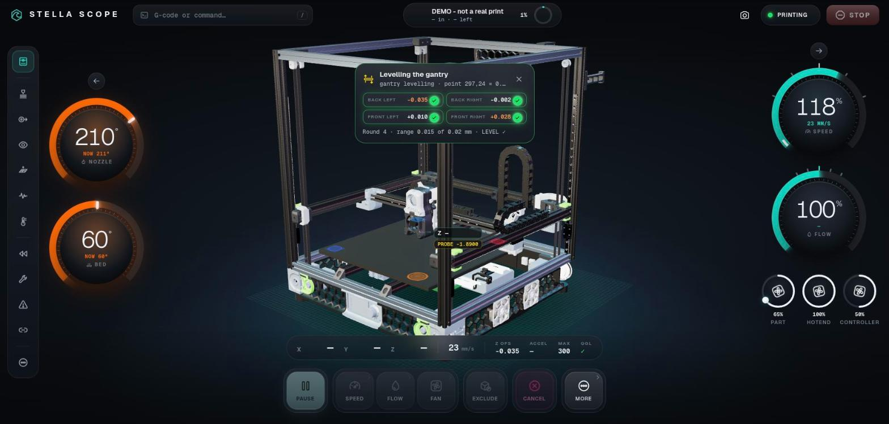
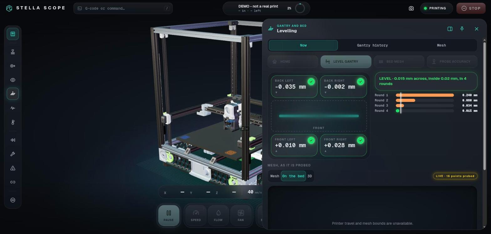

# Stella Scope

**A flight recorder and live cockpit for Klipper 3D printers.** It records everything the printer reports, lets you rewind to any moment, and shows the machine in 3D, on your computer or your phone.



Built by [3D3D](https://3d3d.ca) in New Brunswick, Canada. Downloads and an overview: [3d3d.ca/software/stella](https://3d3d.ca/software/stella).

## What it does

- **Records the printer, all the time.** Stella Scope subscribes to Moonraker's websocket and stores every status change Klipper reports in a local SQLite file: temperatures, positions, fans, stepper drivers, probe hits, bed meshes, levelling runs and console messages. If the stream drops it falls back to polling.
- **Rewinds to any moment.** Pick a time and every page shows the machine as it was then. Missing data stays marked as unknown; nothing is filled in.
- **Shows the machine in 3D.** The gantry and toolhead follow the recorded coordinates on a CAD model of the printer, with click-to-inspect parts, the recorded bed mesh and recent probe points.
- **Explains problems.** Levelling history, bed-mesh trends, driver warnings, Z-offset changes and the slicer settings of each print, with the evidence behind every reading.
- **Follows you.** Pair a phone once with a QR code; the Android app reaches Stella Scope directly when it can and through an end-to-end encrypted relay when it cannot.
- **Watches prints.** Optional failure detection runs Obico's open spaghetti-detection model on your own computer, from your camera, with nothing sent to a cloud.
- **Tells you.** Optional WhatsApp alerts (through CallMeBot) when a print finishes or fails, Klipper stops, or a driver warns.



## Safe by default

Stella Scope is a recorder first. Printer controls are **off** unless you set `controls_enabled` in the configuration, and even then they only work on a loopback bind, never in replay or demo mode. Building or running it does not change Klipper, Moonraker, macros, firmware or any printer setting. The web interface has no login of its own: keep it on `127.0.0.1` or behind your own network controls, and never expose it to the internet.

## Try it

You need Rust (stable, via [rustup](https://rustup.rs)), Git and a C compiler.

```sh
git clone https://github.com/3d3dcanada/stella-scope.git
cd stella-scope
cargo build --release --locked
./target/release/stella-scope --demo --db demo.sqlite3
```

Open <http://127.0.0.1:7420/>. `--demo` plays built-in synthetic data and never connects to a printer.

To see the printer in 3D, install the basic Voron 2.4 model (a 12 MB download, details in [docs/BASIC-MODEL.md](docs/BASIC-MODEL.md)):

```sh
tools/basic-model/install.sh demo.sqlite3
```

## Use it with your printer

```sh
cp stella-scope.example.json stella-scope.json   # set moonraker_url to your printer
./target/release/stella-scope --config stella-scope.json
./target/release/stella-scope --replay stella-scope.sqlite3   # read-only rewind of a recording
./target/release/stella-scope --print-config                  # every setting and its default
```

Retention is bounded (`keep_days`, `max_db_mb`) and the oldest data is pruned first. If Moonraker needs an API key, put it in the `STELLA_MOONRAKER_API_KEY` environment variable, not in the file. The resonance band on the levelling page uses the `shaper_freq_y` from your Klipper `[input_shaper]` section.

To run it as a service on the printer's host, see [deploy/README.md](deploy/README.md). Nothing there is installed automatically.

**Linux and Android packages** are on [3d3d.ca/software/stella](https://3d3d.ca/software/stella#download).

## What is in this repository

| Path | What it is |
|---|---|
| `src/`, `web/`, `static/` | The recorder and web interface: one synchronous Rust binary with six direct dependencies, no async runtime and no CDN. |
| `desktop/` | Desktop app (Tauri) for the computer next to the printer: finds the printer, starts the recorder, the phone link and the failure watch. |
| `mobile/` | The Android app. It dials a paired Stella Scope by key and shows it. |
| `link/` | The phone link: an end-to-end encrypted pipe over [iroh](https://www.iroh.computer/) with NAT traversal and relay fallback. |
| `eye/` | Print-failure detection with Obico's open model, run locally with [tract](https://github.com/sonos/tract). |
| `tools/asset-import/` | Imports STL and STEP files (a whole printer, or a part) into the model library. |
| `tools/basic-model/` | Builds and installs the basic Voron 2.4 model. |
| `deploy/` | An optional, hand-installed systemd service template and a desktop launcher. |
| `scripts/`, `tests/` | Test scripts and fixtures. |

## Tests

```sh
cargo test --locked
for t in service-core hud-core hud-gcode next-core next-gesture next-pages workspace-core; do node scripts/$t-tests.mjs; done
node scripts/service-http-smoke.mjs && node scripts/workspace-http-smoke.mjs && node scripts/investigation-smoke.mjs
```

The smoke scripts start their own instance against a fake Moonraker and need a release build first.

## Status

Version 0.4.2. Developed against a Voron 2.4 R2 350; the recorder and every page work with any Klipper printer that runs Moonraker, but the 3D view knows only the Voron 2.4 layout so far. Windows and macOS builds are not available yet.

## Licence

GNU Affero General Public License v3.0. See [LICENSE](LICENSE). Third-party components and their licences are listed in [THIRD_PARTY.md](THIRD_PARTY.md). Klipper, Moonraker, Voron and Obico are the work of their own projects; Stella Scope is not affiliated with them.

Copyright 2026 3D3D.
